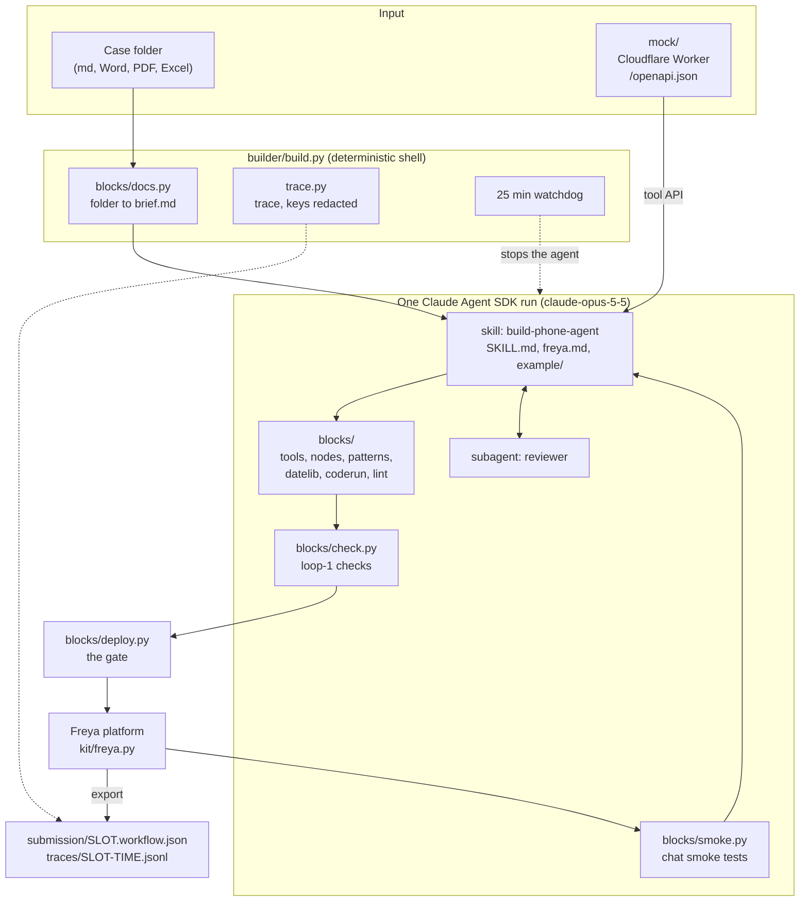
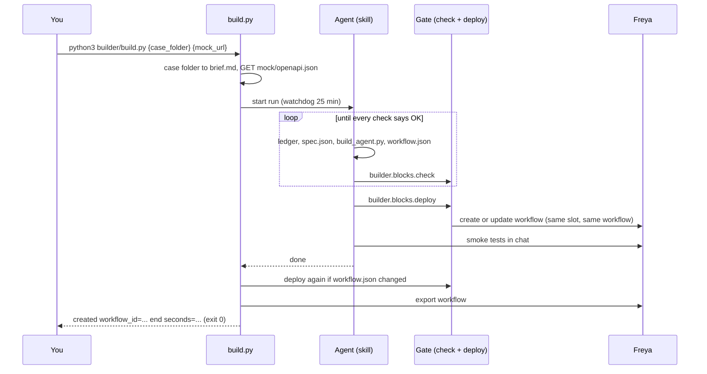
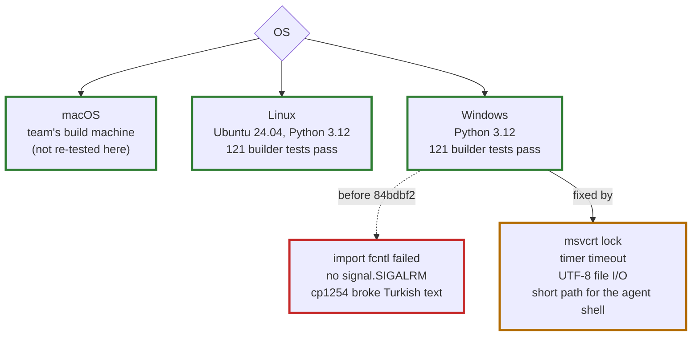

# How the builder is put together, and where it runs

State at 11 October 2026, 17:15 UTC. Diagrams are Mermaid: GitHub draws them.

## 1. Components

| Part | Where | Role |
|---|---|---|
| Shell | `builder/build.py`, `builder/trace.py` | Brief and tool API into a run folder, one agent run, final deploy through the gate, export, trace. |
| Agent instructions | `builder/.claude/skills/build-phone-agent/` | The procedure, the platform knowledge, a worked example. |
| Reviewer and limits | `builder/.claude/agents/reviewer.md`, `builder/.claude/settings.json` | Independent review before hand-off. Denies reading `runs/`, `eval/`, `context/`; blocks `curl` and `wget`. |
| Tested blocks | `builder/blocks/` | Documents to text, tools from any API file, node factories, proven patterns, date helpers, linter, checks, deploy gate, smoke tests. |
| Platform client | `kit/freya.py` | The organizers' Freya API client. |
| Bank mock | `mock/` | Cloudflare Worker with one Durable Object. The phone agent may call only this. |
| Not needed to run | `eval/`, `notes/`, `builder/tests/` | Evaluation, notes, tests. |

## 2. One run

## 3. Set up and run

The step-by-step guide, for macOS, Linux and Windows, is in the [README](../README.md#setup-from-scratch). The final-case checklist is `notes/hidden-runbook.md` (written for macOS).

## 4. Which OS runs it

Commit `84bdbf2` made Windows work. Before it, the builder did not import on Windows. The macOS and Linux code paths are unchanged.

| OS | Checked | Result |
|---|---|---|
| macOS | Live builds by the team | Works. Not re-tested on 11 October. The code it runs is the same as before. |
| Linux | Fresh export of the commit in WSL Ubuntu (Python 3.12): 121 builder tests, 38 eval tests, contamination 0 | Pass. Needs `python3-venv`. The `fcntl` and `SIGALRM` paths are still the ones used. |
| Windows | 121 builder tests, 38 eval tests, contamination 0. A one-turn Claude Agent SDK run whose Bash tool ran `$BUILDER_PYTHON` and imported `builder` | Pass. |

**How the Windows paths are kept apart:**

- `deploy.py`: `fcntl.flock` is tried first; only if `fcntl` does not exist, `msvcrt.locking` waits in a loop.
- `check.py`: `SIGALRM` is used when it exists; otherwise a `threading.Timer` calls `_thread.interrupt_main` and the code turns it into `SnippetTimeout`.
- `build.py`: `PYTHONUTF8=1`, the UTF-8 stdout and the short DOS-style `BUILDER_PYTHON` path (a path with a space cannot be split by the agent's shell) apply only when `sys.platform == "win32"`.
- Every `read_text`, `write_text` and `open` in `builder/` names `encoding="utf-8"`. That is the encoding macOS and Linux already used.
- Two new tests cover the timeout and the lock on every OS.

**Not verified:** a full live build on Windows (it needs Freya workflow quota; the one-turn agent run above covers the agent shell only), and Python 3.10 and 3.11.
