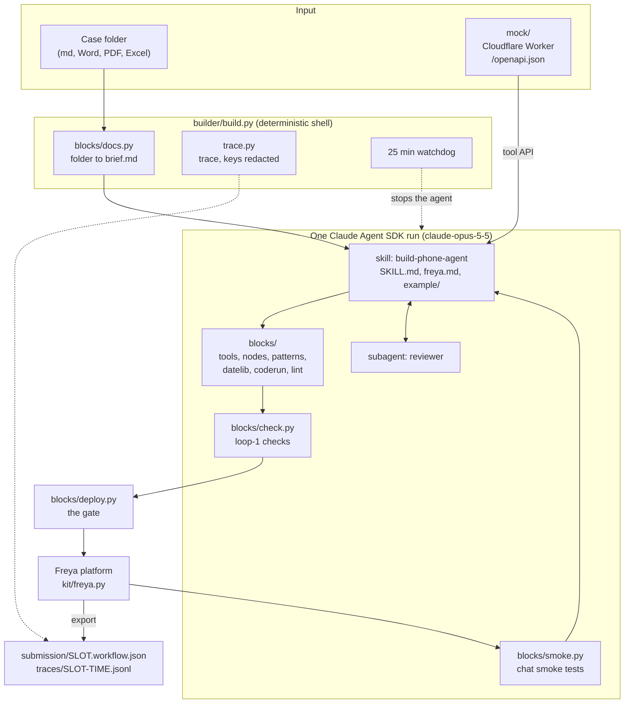
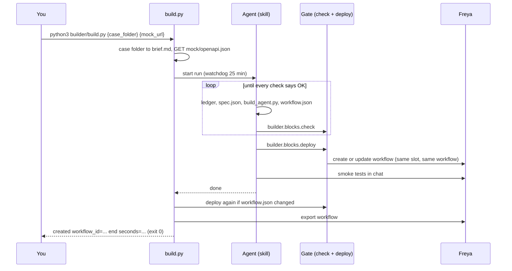
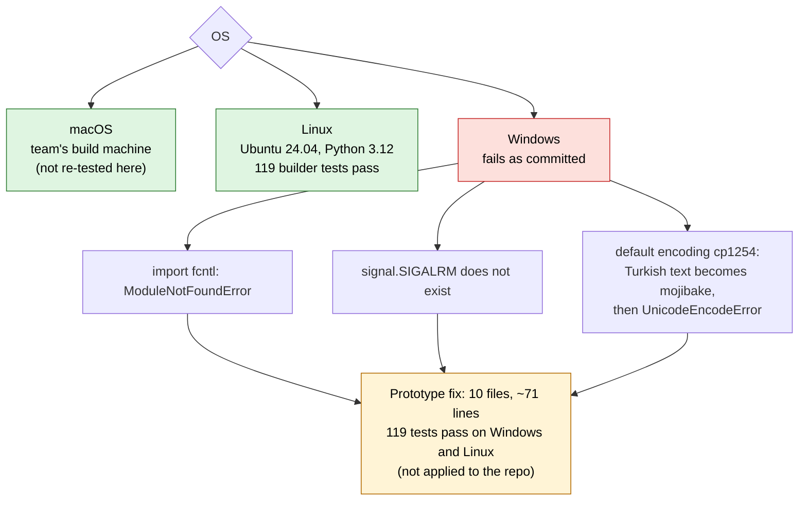

# How the builder is put together, and where it runs

State at 11 October 2026, 17:15 UTC. Diagrams are Mermaid: GitHub draws them.

## 1. Components

| Part | Where | Role |
|---|---|---|
| Shell | `builder/build.py`, `builder/trace.py` | Brief and tool API into a run folder, one agent run, final deploy through the gate, export, trace. |
| Agent instructions | `builder/.claude/skills/build-phone-agent/` | The procedure, the platform knowledge, a worked example. |
| Reviewer and limits | `builder/.claude/agents/reviewer.md`, `builder/.claude/settings.json` | Independent review before hand-off. Denies reading `runs/`, `eval/`, `context/`; blocks `curl` and `wget`. |
| Tested blocks | `builder/blocks/` | Documents to text, tools from any API file, node factories, proven patterns, date helpers, linter, checks, deploy gate, smoke tests. |
| Platform client | `kit/freya.py` | The organizers' Freya API client. |
| Bank mock | `mock/` | Cloudflare Worker with one Durable Object. The phone agent may call only this. |
| Not needed to run | `eval/`, `notes/`, `builder/tests/` | Evaluation, notes, tests. |

## 2. One run

## 3. Set up from scratch

1. Python 3.10 or newer (tested on 3.12). On Debian and Ubuntu: `sudo apt install python3-venv`.
2. `python3 -m venv .venv`, activate it, `pip install -r requirements.txt`.
3. Copy `kit/env.example` to `env.sh`, fill in `FREYA_API_KEY` and `FREYA_BANK_TEAM_KEY`. On macOS and Linux: `source env.sh`. PowerShell does not read `env.sh`; set the three variables with `$env:NAME = "value"`.
4. A Claude login (`claude auth login`, the binary is in the SDK package) or `ANTHROPIC_API_KEY`.
5. Run: `python3 builder/build.py {case_folder} {mock_url}`.
6. Node and `npx wrangler deploy` are needed only to redeploy `mock/`.

The final-case steps are in `notes/hidden-runbook.md` (written for macOS).

## 4. Which OS runs it

| OS | Checked | Result |
|---|---|---|
| macOS | Live builds by the team | Works. Not re-tested on 11 October. |
| Linux | Fresh install of the committed files in WSL Ubuntu (Python 3.12), `pytest builder/tests` | 119 pass. Needs `python3-venv`. |
| Windows | Same tests, as committed | The import of `builder.blocks.deploy` fails, so nothing runs. |

**Not verified:** a full live build on Windows (the agent's Bash tool needs Git Bash, and a `$BUILDER_PYTHON` path with backslashes may break there); Python 3.10 and 3.11.

**Windows fix, if wanted** (prototype, tested, not in `builder/`):

- `deploy.py`: `fcntl.flock` becomes a `msvcrt.locking` fallback that waits in a loop.
- `check.py`: without `SIGALRM`, a `threading.Timer` calls `_thread.interrupt_main` and the code turns it into `SnippetTimeout`.
- Every `read_text`, `write_text` and `open` gets `encoding="utf-8"`; the agent's child processes get `PYTHONUTF8=1`; stdout is reconfigured to UTF-8.
- The test fixtures are written as UTF-8.
